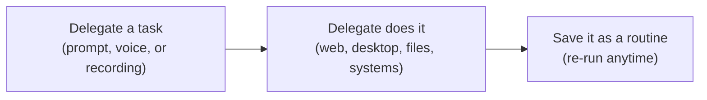

# Installation Guide

## Step 1 — Install UiPath Studio (latest STS)

!!! warning "Install the latest STS version"
    Delegate is only in **Short Term Support (STS)** versions of Studio. Install the latest one, even if you already have Studio.

1. Download and run <a href="https://download.uipath.com/connected-installer/latest/sts/UiPathPlatformSTS.msi" target="_blank">UiPathPlatformSTS.msi</a>.
2. Launch Studio and **sign in** to the workshop organization and tenant.
3. Install the **UiPath browser extension**: **Home → Tools → UiPath Extensions**, then select your browser: Chrome or Edge.

**Check it:** Studio shows you signed in to the workshop tenant, and the extension is enabled in your browser.

## Step 2 — Meet Delegate

**UiPath Delegate** is UiPath's productivity agent, and the evolution of UiPath Assistant. You give it a task, and it completes the task end to end on your real machine, in your browsers and desktop apps.



For testing, Delegate is fully integrated with **Test Manager**, so you can hand it testing work across the whole cycle, from planning and authoring tests to running them and reporting on the results.

1. Open **UiPath Assistant** → **Preferences** → **Orchestrator connection**, sign in with your UiPath account, and select the workshop tenant.

    ??? tip "Assistant already shows you signed in and connected?"
        1. Click **Sign out**. Your default browser opens and asks if you want to log out. Don't click it.
        2. In that browser, sign in to the workshop tenant.
        3. Go back to Assistant, click **Sign in**, and follow step 1.

2. Select **Delegate** in the top ribbon. It shows only once Assistant is connected.

3. Click **+ New** in the left panel to start your session. Use this one session for the whole workshop.

### Choose how much Delegate does on its own

Select **Adaptive** from the mode selector next to the chatbox (or **Settings → Security**) and turn **Smart approvals** on.

| Approval mode | What Delegate does |
|---|---|
| **Cautious** | Asks before every operation |
| **Adaptive** *(recommended)* | Auto-approves known safe operations, and asks before the rest. **Smart approvals** also approves what Delegate judges safe |
| **Full access** | Never asks — trusted environments only |

### Check the connection

1. Ask Delegate:

    ```text
    List the tenant I am connected to.
    ```

    Delegate replies with your organization, tenant and user name. If the tenant isn't the workshop tenant, switch it as in the *Assistant already shows you signed in and connected?* tip, and ask again.

2. Ask Delegate:

    ```text
    Run uip login status.
    ```

    If it says you're not signed in, ask Delegate to run `uip login`, and sign in with your workshop account. Don't continue until the login status comes back clean.

!!! warning "Delegate acts on your behalf"
    It uses your UiPath account and permissions, and every action is logged in your name.

    ✅ Keep screen context on **Default** (the screen icon next to the chatbox), so Delegate sees only the apps attached to the chat.

    ✅ In **Settings → Security → Blocked websites**, quick-add **Banking**, **Payments** and **Password Manager**.

---

[Next → Introduction: Test Cloud & Test Manager](../module-1-introduction/index.md){: .md-button .md-button--primary}

---
