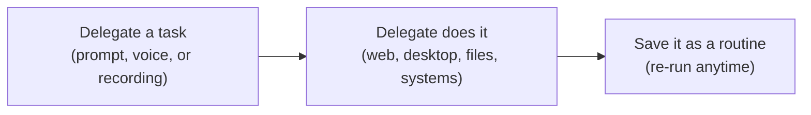

# Prerequisites

Use this checklist to confirm you're ready **before the workshop starts**.

## Your machine

✅ A **Windows 10 or 11** laptop. The workshop uses Studio Desktop, and your machine runs your tests as a robot.

✅ **Local admin rights**, to install Studio and the UiPath browser extension

✅ A browser: **Google Chrome** or **Microsoft Edge**

✅ **UiPath Studio**, latest STS version: download and run <a href="https://download.uipath.com/connected-installer/latest/sts/UiPathPlatformSTS.msi" target="_blank">UiPathPlatformSTS.msi</a>

!!! warning "Install the latest STS version"
    Delegate is only in **Short Term Support (STS)** versions of Studio. Install the latest one, even if you already have Studio.

✅ Access to <a href="https://cloud.uipath.com" target="_blank">cloud.uipath.com</a> and <a href="https://uibank.uipath.com" target="_blank">uibank.uipath.com</a>, with no proxy or firewall blocking them

## Accounts and access

!!! info "Access is provided by your trainer"
    Your trainer gives you access to the workshop **organization** and **tenant** and guides you through signing in.

    Trainers: see [Trainer Setup](../trainer-setup.md).

Confirm that you can:

✅ Sign in to <a href="https://cloud.uipath.com" target="_blank">UiPath Automation Cloud</a> and open the workshop **organization** and **tenant**

✅ Open **Test Manager** and **Orchestrator** in that tenant

## Connect Studio and Delegate

1. Launch Studio and **sign in** to the workshop organization and tenant.
2. Open **UiPath Assistant** → **Preferences** → **Orchestrator connection**, sign in with your UiPath account, and select the workshop tenant.

    ??? tip "Assistant already shows you signed in and connected?"
        1. Click **Sign out**. Your default browser opens and asks if you want to log out. Don't click it.
        2. In that browser, sign in to the workshop tenant.
        3. Go back to Assistant, click **Sign in**, and follow step 2.

3. Select **Delegate** in the top ribbon. It shows only once Assistant is connected.
4. Click **+ New** in the left panel to start your session. Use this one session for the whole workshop.

!!! success "Check it"
    ✅ Studio shows you signed in to the workshop tenant.

    ✅ **Home → New Project** lists **Test Automation**. No Test Automation option? Ask your trainer to check your license.

    ✅ The UiPath extension is enabled in your browser.

    ✅ Delegate opens from Assistant's top ribbon.

## Set up Delegate

**UiPath Delegate** is UiPath's productivity agent, and the evolution of UiPath Assistant. You give it a task, and it completes the task end to end on your real machine, in your browsers and desktop apps.



For testing, Delegate is fully integrated with **Test Manager**, so you can hand it testing work across the whole cycle, from planning and authoring tests to running them and reporting on the results.

### Choose how much Delegate does on its own

Select **Adaptive** from the mode selector next to the chatbox (or **Settings → Security**) and turn **Smart approvals** on.

| Approval mode | What Delegate does |
|---|---|
| **Cautious** | Asks before every operation |
| **Adaptive** *(recommended)* | Auto-approves known safe operations, and asks before the rest. **Smart approvals** also approves what Delegate judges safe |
| **Full access** | Never asks — trusted environments only |

### Check the connection

1. Ask Delegate:

    ```text
    List the tenant I am connected to.
    ```

    !!! tip "Delegate asks to approve PowerShell?"
        Running PowerShell is a high-risk tool, so Delegate asks even in **Adaptive**. Select **Allow Run PowerShell for this session**. Delegate then runs PowerShell without asking for the rest of your session.

    Delegate replies with your organization, tenant and user name. If the tenant isn't the workshop tenant, switch it as in the *Assistant already shows you signed in and connected?* tip, and ask again.

2. Ask Delegate:

    ```text
    Run uip login status.
    ```

    If it says you're not signed in, ask Delegate to run `uip login`, and sign in with your workshop account. Don't continue until the login status comes back clean.

!!! warning "Delegate acts on your behalf"
    It uses your UiPath account and permissions, and every action is logged in your name.

    ✅ Keep screen context on **Default** (the screen icon next to the chatbox), so Delegate sees only the apps attached to the chat.

    ✅ In **Settings → Security → Blocked websites**, quick-add **Banking**, **Payments** and **Password Manager**.

## Orchestrator folder and robot

Signing in to Automation Cloud lets you open Test Manager, but not run tests. Test Manager runs tests through **Orchestrator**, on a **robot**, in a **folder**. Your folder holds:

✅ **Your permissions**, which let you run tests in that folder

✅ **Your machine**, with a testing runtime, where the robot runs your tests


??? info "Trainer-led setup: your folder and machine"
    Do this with your trainer, before or at the start of the workshop, as they tell you.

    **Create your folder**

    1. Create a personal folder, as your trainer guides you. You'll assign your machine to it.
    2. You get your permissions through a group your trainer sets up. You don't need to set them yourself.
    3. In the Enterprise setup, use **Custom Windows credentials**:

        ✅ **Username:** open a command prompt, run `whoami`, and enter exactly what it returns.

        ✅ **Password:** your Windows sign-in password. Sign in with a Windows Hello PIN? Set **Credential type** to **Smart Card** and enter the PIN as the password.

        ✅ No password, or not sure? Tell your trainer before the workshop.

        See <a href="https://docs.uipath.com/orchestrator/standalone/2023.4/user-guide/configuring-robot-accounts-to-run-unattended-automation" target="_blank">Configuring robot accounts</a> (username formats) and <a href="https://docs.uipath.com/robot/standalone/2025.10/admin-guide/using-entraid-users-with-multifactor-authentication-mfa-with-robots" target="_blank">Using Entra ID users with MFA</a> (Windows Hello PIN).

        { width="400" }

    !!! tip "Workshop shortcut"
        Your own user runs the tests. In production, an admin assigns a dedicated **robot account** and a machine template to the folder.

    **Set up your machine and folder**

    1. In Orchestrator, select **Tenant** (top left) → **Machines**, and search for your name.

        

    2. Edit your machine template. Under **Runtime details**, set **App Testing** or **Testing** to **1**, whichever you see, and save.

        

    3. Still at the **Tenant** level, go to **Folders** and open your personal folder. In the **Manage Access** tab, check that your username is listed, with **Attended, Unattended** under **Robot Type**.

        

    4. Open the **Machines** tab, next to **Manage Access**. Click **Manage Machines in Folder**, select your machine, then click **Update** to add it to the folder.

        

    **Check it:** in your folder, **Machines** lists your machine with **1** under **App Testing** or **Testing**.

    **Check it later:** your robot setup is only proven when Test Manager runs a test on your machine. You do that in [7. Add Test Cases to the Smoke Test Set](../module-2-hands-on-workshop/07-create-test-set.md), once you have an automated, published test case. If the run fails to start or sign in, check the Windows username and password here.

---

[Next → Introduction: Test Cloud & Test Manager](../module-1-introduction/index.md){: .md-button .md-button--primary}
