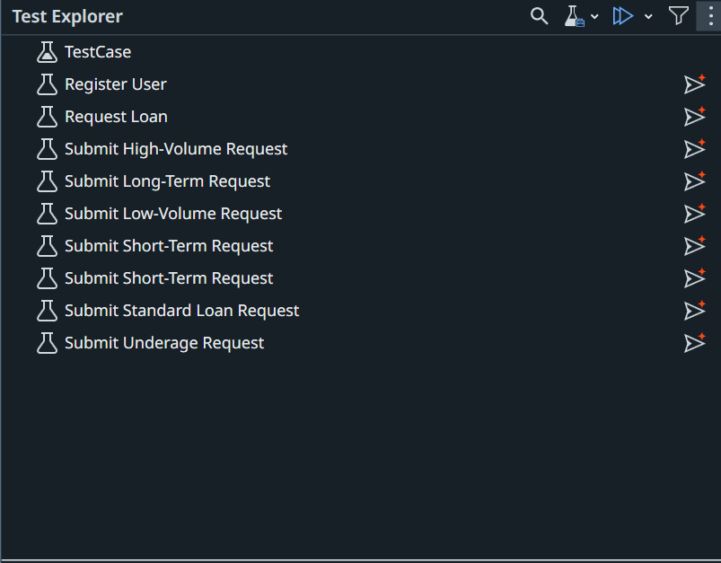

# 05. Automate Test Cases with Studio Desktop and Delegate

Automate your manual test cases in Studio with Delegate. Each automation stays **linked** to its test case in Test Manager.

!!! warning "Access required"
    You need an **App Test Developer** license to create and publish Test Automation projects.

## What you'll do

You switch between **two tools** on this page. Each step is labelled with the one it uses:

| Tool | What you do |
|---|---|
| <span class="tool-badge tool-badge--delegate">Delegate</span> | Paste the prompt in Delegate, then wait and watch it build in Studio |
| <span class="tool-badge tool-badge--studio">Studio Desktop</span> | Work in Studio Desktop yourself, with **Autopilot for Testers** |

Click a step to jump to it.

<div class="flow">
  <div class="flow-part flow-part--delegate" style="--steps: 4">
    <span class="flow-part-label">Delegate</span>
    <div class="flow-part-steps">
      <a class="flow-step" href="#create-a-test-automation-project">Create a Test Automation project</a>
      <span class="flow-arrow"></span>
      <a class="flow-step" href="#install-the-ui-automation-package">Install the UI Automation package</a>
      <span class="flow-arrow"></span>
      <a class="flow-step" href="#link-studio-to-your-test-manager-project">Link Studio to your Test Manager project</a>
      <span class="flow-arrow"></span>
      <a class="flow-step" href="#build-the-object-repository">Build the Object Repository</a>
    </div>
  </div>
  <span class="flow-arrow"></span>
  <div class="flow-part flow-part--studio" style="--steps: 2">
    <span class="flow-part-label">Studio Desktop</span>
    <div class="flow-part-steps">
      <a class="flow-step" href="#automate-the-test-cases-with-studio-desktop">Automate the test cases with Autopilot</a>
      <span class="flow-arrow"></span>
      <a class="flow-step" href="#generate-test-data">Generate test data</a>
    </div>
  </div>
  <span class="flow-arrow"></span>
  <div class="flow-part flow-part--delegate" style="--steps: 1">
    <span class="flow-part-label">Delegate</span>
    <div class="flow-part-steps">
      <a class="flow-step" href="#publish-the-test-cases">Publish the test cases</a>
    </div>
  </div>
</div>

## Create a Test Automation project

<span class="tool-badge tool-badge--delegate">Delegate</span>

Replace `<YOUR_NAME>` with your name, for example `AlexS`, so your package is unique on the shared tenant. Then paste:

```text
Create a Studio Test Automation project named <YOUR_NAME>_UiBank Tests.
```

**Check it:** your project opens in Studio, in `Documents\UiPath\<YOUR_NAME>_UiBank Tests`.

## Install the UI Automation package

<span class="tool-badge tool-badge--delegate">Delegate</span>

```text
Install the latest stable UI Automation activities package in <YOUR_NAME>_UiBank Tests.
```

**Check it:** **Manage Packages → Project Dependencies** lists **UiPath.UIAutomation.Activities**.

## Link Studio to your Test Manager project

<span class="tool-badge tool-badge--delegate">Delegate</span>

Paste:

```text
Connect this project to my Test Manager project, then open Test Explorer to show its test cases.
```

**Check it:** the connection icon is green, and **Test Explorer** lists your test cases.

## Build the Object Repository

<span class="tool-badge tool-badge--delegate">Delegate</span>

The **Object Repository** stores the app's screens and UI elements for every test case to reuse. 


Building it by hand is usually one of the slowest parts of test automation: you capture every screen and element yourself. Tell Delegate what to capture, and it builds the repository for you. To cover every screen and element the test cases need, use the prompt below.


!!! example "Delegate"
    1. Prompt in Delegate:

        ```text
        Create an Object Repository in UiPath Studio Desktop for the UiBank web app running in Chrome.

        Application
        - Name: UiBankORForChrome
        - Browser: Chrome
        - Capture each element live in the browser
        - Prefer stable selectors (id, name, aria-label, visible text) over index-based ones
        - Avoid dynamic values in selectors
        - Name each element exactly as listed below

        Screens and elements

        1. Screen: Home (https://uibank.uipath.com/welcome)
           - Username (input)
           - Password (input)
           - Sign In (button)
           - Products (dropdown menu)
           - Loans (menu item in the Products dropdown; open Products first so Loans is visible when you capture it)

        2. Screen: Selection (https://uibank.uipath.com/loans)
           - Apply For A Loan (button; the one on the Loans page, not the Apply For Loan button on the Welcome page)
           - Already Have A Loan? (button)

        3. Screen: Form (https://uibank.uipath.com/loans/apply)
           - Email (input)
           - Amount (input)
           - Term (dropdown)
           - Income (input)
           - Age (input)
           - Submit (button)

        4. Screen: Quote (the results view shown after you submit the loan application)
           - Result Text: the full text block of the response
           - Rate: only the number shown below "With a fantastic rate of:", without the "%" sign
           - Loan ID: the value shown below "Your new loan ID is:"
           Anchor these elements to their label text, not to the changing values, so the selectors work for any result.
           To reach this screen, submit the form with sample valid values. Save the Loan ID for screen 6.

        5. Screen: Loan Lookup (https://uibank.uipath.com/loans/lookup)
           - Loan ID (input)
           - Retrieve Loan Details (button)

        6. Screen: Loan Lookup Result (the results view shown after you look up a Loan ID)
           - Result Text: the full text block of the response
           - Loan ID: the value shown beside its label, anchored to the label text
           To reach this screen, look up the Loan ID you saved from screen 4.

        Acceptance criteria
        - All 6 screens and 20 elements exist under UiBankORForChrome, named as above
        - Every selector validates (highlights the correct element) on its live screen
        - Report any element you could not capture reliably, and why
        ```

    2. Don't use your desktop or browser while it captures.

??? tip "Write your own Object Repository prompt"
    Describe what you need in plain language, such as the app, its screens, and the elements to capture. Delegate can also review and fine-tune your prompt, or fix it when something's missed.

??? tip "Check it"
    1. In Studio's **Object Repository** panel, expand **UiBankORForChrome**. It lists all 6 screens and their elements. If it's empty, reload the project.

        { width="300" }

    2. Open UiBank in Chrome on the Welcome screen. Right-click an element, such as **Username**, and select **Highlight**.

        { width="300" }

    3. In the browser, the element is outlined in **green**, and its label anchor in **blue**. Repeat for a few elements on each screen.

        

    If an element doesn't highlight, ask Delegate to recapture it.

!!! warning "Complete this step before you continue"
    **Autopilot for Testers** builds your test cases from the Object Repository elements. Without them, it can't automate the test cases in the next step.

!!! info "Switch to Studio Desktop"
    Delegate has set up the project and built the Object Repository. For the next two steps, **you work directly in Studio Desktop**, using **Autopilot for Testers** to turn your manual test cases into automations.

## Automate the test cases with Studio Desktop

<span class="tool-badge tool-badge--studio">Studio Desktop</span>

Automate **every** test case with the **Coding Agent WS** label: the ones the built-in agent created in [03. Generate Test Cases](03-generate-test-cases.md), and the ones Delegate created in [04. Run Manual Tests](04-run-manual-tests.md). Your test set in [06. Create a Test Set](06-create-test-set.md) runs all of them.

1. In **Test Explorer**, right-click one of these test cases → **Generate Test Case with Autopilot**.

    

2. Remember it uses **Object Repository** elements and the expected results. 
3. Check the **Use Application/Browser** cards. The data-driven test in the next section must open and close the app once per row, and your requirement and test case may not say so.

    ✅ **First card:** set **Open** to **Always**.

    ✅ **Last card:** set **Close** to **Always**.

    ✅ **Cards in between:** keep **Open** and **Close** as **Never**.

    Select a card, then set **Open** and **Close** under **Properties → Options**. Here, the first card opens the app and leaves it open:

    

4. **Run** it locally.
5. Repeat for each test case with the **Coding Agent WS** label.
6. **Make one test case fail.** In one automated test case, change an input value so it breaks a rule in the requirement, such as an age or income outside the limits. Keep the expected result as it is, and run it again. It fails, which gives the report in [07. Run and Report](07-run-and-report.md) a real failure to show.

**Check it:** each test case passes locally, except the one you made fail in step 6.

??? example "Optional: Fix the activity display names"
    Autopilot names each activity after its manual step, including the test data, which makes long, hard-to-read display names.

    1. Replace **Submit Short-Term Request** with the name of the test case you generated, then paste in Delegate:

        ```text
        I've created test case Submit Short-Term Request using autopilot feature in Studio. Fix the Display names. Provide appropriate names.
        ```

    2. Reload the test case in Studio and check the new names.

## Generate test data

<span class="tool-badge tool-badge--studio">Studio Desktop</span>

TBD

## Publish the test cases

<span class="tool-badge tool-badge--delegate">Delegate</span>

!!! info "Switch back to Delegate"
    Your test cases are automated. Go back to Delegate to publish them.

Paste:

```text
Set all the test cases in <YOUR_NAME>_UiBank Tests as publishable and publish the project.
```

**Check it:** in Test Manager, open **Test Cases**. Each one you automated shows as **Automated**. Open one and check that its **Automation** tab shows your package, named after your project.

!!! warning "Don't continue until every labelled test case is automated"
    Your test set in [06. Create a Test Set](06-create-test-set.md) runs every test case with the **Coding Agent WS** label. Any test case that isn't automated breaks the run and the report.

    Replace `<YOUR_STUDIO_PROJECT>` with your Studio project name, for example **AlexS_UiBank Tests**. Then paste in Delegate:

    ```text
    List every test case in my Test Manager project with the label 'Coding Agent WS'. For each one, tell me whether it's linked to a Studio project named '<YOUR_STUDIO_PROJECT>'. List the ones that aren't.
    ```

    Automate any test case on that list, publish again, then ask again. Continue only when the list is empty.

## Nice work!

Your test cases are automated, data-driven, and published, ready to run from Test Manager.

---

[Next → 06. Create a Test Set](06-create-test-set.md){: .md-button .md-button--primary}

---
