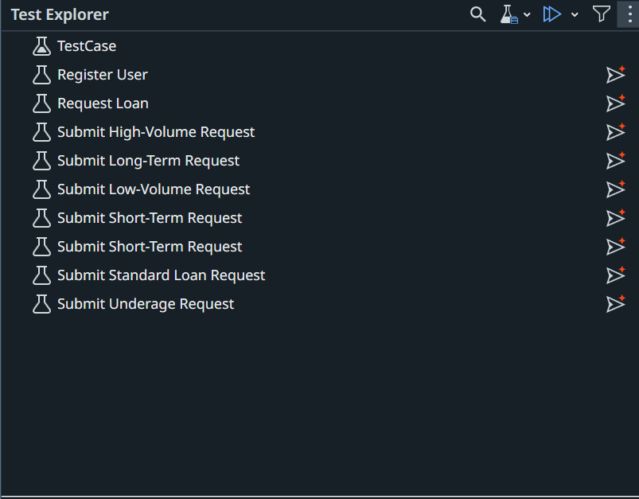

# 06. Automate and Publish the Test Cases

Turn your manual test cases into automations with **Autopilot for Testers** in Studio, then publish them with Delegate. Each automation stays **linked** to its test case in Test Manager.

!!! info "Before you start"
    ✅ Your Studio project is linked to Test Manager, and the **UiBankORForChrome** Object Repository is built, from [05. Set Up Studio and Build the Object Repository](05-build-object-repository.md).

## What you'll do

You switch between **two tools** on this page. Each step is labelled with the one it uses:

| Tool | What you do |
|---|---|
| <span class="tool-badge tool-badge--studio">Studio Desktop</span> | Work in Studio Desktop yourself, with **Autopilot for Testers** |
| <span class="tool-badge tool-badge--delegate">Delegate</span> | Paste the prompt in Delegate, then wait and watch it work in Studio |

Click a step to jump to it.

<div class="flow">
  <div class="flow-part flow-part--studio" style="--steps: 2">
    <span class="flow-part-label">Studio Desktop</span>
    <div class="flow-part-steps">
      <a class="flow-step" href="#automate-the-test-cases-with-studio-desktop">Automate the test cases with Autopilot</a>
      <span class="flow-arrow"></span>
      <a class="flow-step" href="#attach-test-data">Attach test data</a>
    </div>
  </div>
  <span class="flow-arrow"></span>
  <div class="flow-part flow-part--delegate" style="--steps: 1">
    <span class="flow-part-label">Delegate</span>
    <div class="flow-part-steps">
      <a class="flow-step" href="#publish-the-test-cases">Publish the test cases</a>
    </div>
  </div>
</div>

## Automate the test cases with Studio Desktop

<span class="tool-badge tool-badge--studio">Studio Desktop</span>

Automate **every** test case with the **Coding Agent WS** label: the 3 or more you chose in [03. Generate Test Cases](03-generate-test-cases.md). Your test set in [07. Create a Test Set](07-create-test-set.md) runs all of them.

1. In **Test Explorer**, right-click one of these test cases → **Generate Test Case with Autopilot**.

    

2. Review it like a pull request: Given / When / Then sections, one verification for the expected result, **Object Repository** elements only, and no fixed **Delay** activities. If not, ask Delegate to fix it.
3. Check the **Use Application/Browser** cards. The data-driven test in the next section must open and close the app once per row, and your requirement and test case may not say so.

    ✅ **First card:** set **Open** to **Always**.

    ✅ **Last card:** set **Close** to **Always**.

    ✅ **Cards in between:** keep **Open** and **Close** as **Never**.

    Select a card, then set **Open** and **Close** under **Properties → Options**. Here, the first card opens the app and leaves it open:

    

4. **Run** it locally.
5. Repeat steps 1–4 for each of your other **Coding Agent WS** test cases, so all 3 or more are automated with Autopilot.

**Check it:** each test case passes locally.

??? example "Optional: Fix the activity display names"
    Autopilot names each activity after its manual step, including the test data, which makes long, hard-to-read display names.

    1. Replace **Submit Short-Term Request** with the name of the test case you generated, then paste in Delegate:

        ```text
        I've created test case Submit Short-Term Request using autopilot feature in Studio. Fix the Display names. Provide appropriate names.
        ```

    2. Reload the test case in Studio and check the new names.

## Attach test data

<span class="tool-badge tool-badge--studio">Studio Desktop</span>

Next, you attach test data to one of the test cases you automated, so it runs once for each set of values in the **UiBankTestData** entity.

One row expects the loan to be rejected, but UiBank approves it, so this test case fails. That's on purpose: it gives the report in [08. Run and Report](08-run-and-report.md) a real failure to show.

1. In **Test Explorer**, right-click one of your automated test cases, and select **Add Test Data**.
2. Choose **Data Service**, and link the **UiBankTestData** entity.
3. Map the workflow arguments to the entity fields.
4. Add a **Verify** activity to compare the actual outcome with **ExpectedOutcome**.
5. Run the test case and check that it runs once for each data variation, and fails on the row with **ExpectedOutcome** set to **FALSE**.

## Publish the test cases

<span class="tool-badge tool-badge--delegate">Delegate</span>

!!! info "Switch back to Delegate"
    Your test cases are automated. Go back to Delegate to publish them.

Replace `<TEST_CASE_1>`, `<TEST_CASE_2>`, `<TEST_CASE_3>` with the names of the test cases you automated (add more if you have them), then paste:

```text
Set the test cases I generated with Autopilot in <YOUR_NAME>_UiBank Tests (<TEST_CASE_1>, <TEST_CASE_2>, <TEST_CASE_3>) as publishable, and publish the project to the Orchestrator Tenant Processes Feed, not my Personal Workspace.
```

??? tip "Do it by hand in Studio"
    1. In the **Project** panel, right-click each automated test case → **Set as Publishable**.

        

    2. Select **Publish** in the Studio ribbon.

        

    3. In **Publish Test Cases**, check the **Package Name** and **New Version**, then select **Next**.

        

    4. In **Publish options**, choose the **Orchestrator Tenant Processes Feed**, then select **Publish**.

**Check it:** in Test Manager, open **Test Cases**. Each one you automated shows as **Automated**. Open one and check that its **Automation** tab shows your package, named after your project.

!!! warning "Don't continue until every labelled test case is automated"
    Your test set in [07. Create a Test Set](07-create-test-set.md) runs every test case with the **Coding Agent WS** label. Any test case that isn't automated breaks the run and the report.

    Paste in Delegate:

    ```text
    List every test case in my Test Manager project with the label 'Coding Agent WS'. For each one, tell me whether it's linked to a Studio project named '<YOUR_NAME>_UiBank Tests'. List the ones that aren't.
    ```

    Automate any test case on that list, publish again, then ask again. Continue only when the list is empty.

## Nice work!

Your test cases are automated, data-driven, and published, ready to run from Test Manager.

---

[Next → 07. Create a Test Set](07-create-test-set.md){: .md-button .md-button--primary}

---
